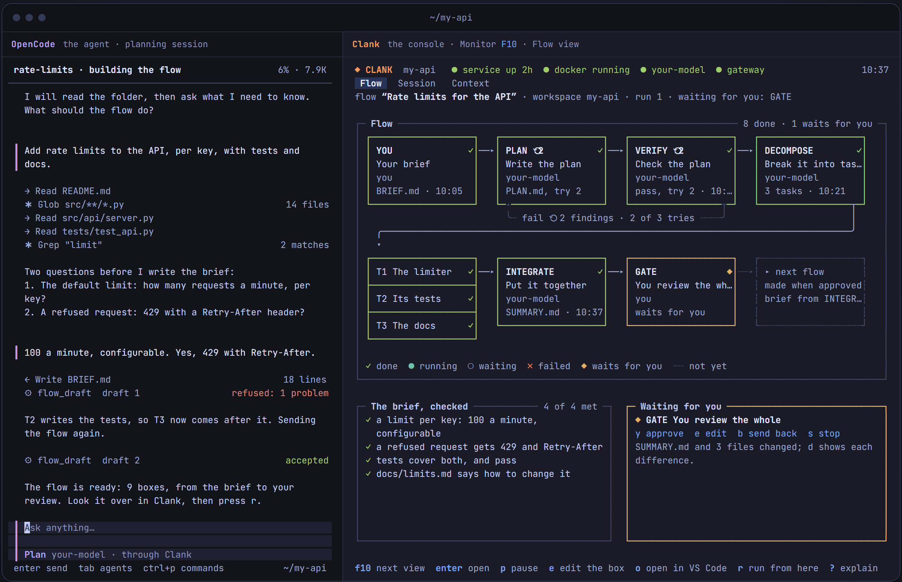
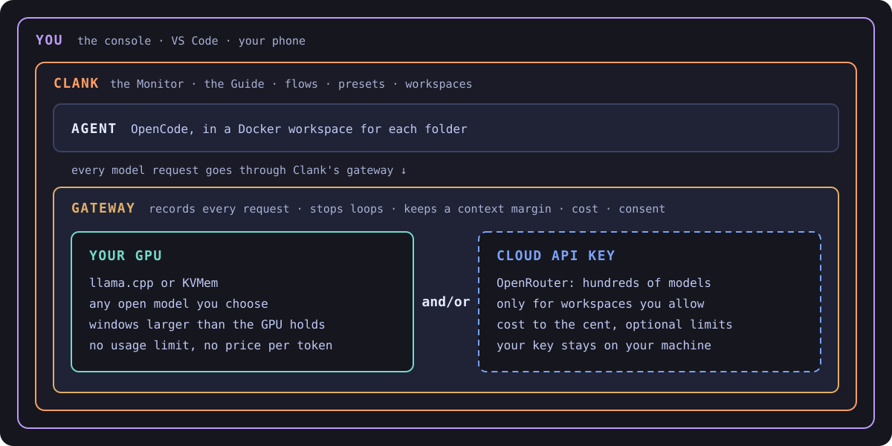

<p align="center">
  <a href="https://clank-ai.github.io"></a>
</p>

<h1 align="center">Precise control over your AI coding agents.</h1>

<p align="center">
  On your GPU and/or a cloud API key, with far less reliance on hosted tools like Codex and Claude Code.
</p>

<p align="center">
  <a href="LICENSE"></a>
  <a href="CHANGELOG.md"></a>
  
  
</p>

<p align="center">
  <a href="https://clank-ai.github.io"><b>Website</b></a> ·
  <a href="docs/getting-started.md"><b>Get started</b></a> ·
  <a href="docs/console.md">The console</a> ·
  <a href="docs/walkthrough.md">Walkthrough</a> ·
  <a href="CHANGELOG.md">Changelog</a>
</p>

<br>

<p align="center">
  
</p>
<p align="center"><sub>OpenCode (left) builds a flow with you; Clank's console (right) shows it taking shape, runs it box by box, and stops only for your review.</sub></p>

<br>

## Why Clank

Clank exists for two reasons.

<table>
<tr>
<td width="50%" valign="top">

**Precise control over the models your agents use**

- Every setting in readable files: the model, its window, its thinking budget, its sampling, its engine.
- Every request recorded, and the context window shown part by part, live.
- The agent watched and steered while it works: stop, pause, add a note, compact, undo a step, drop a tool's result.
- Runaway answers stopped by the gateway's loop guard.
- Work split into flows of fresh sessions, each prepared with exactly the context it needs.

</td>
<td width="50%" valign="top">

**Far less dependence on the cloud**

- Local models on your own GPU: no usage limits, no price per token.
- Context windows larger than your GPU holds.
- The cloud only when you choose it, workspace by workspace, with its cost to the cent.
- A different model for each task, local or cloud.
- Your code and your data stay on your machine.
- Open source, all the way down.

</td>
</tr>
</table>

Clank's aim is to be far more useful than a hosted coding agent, because nothing about how your models run is hidden
from you or decided for you.

## Made to be forked

Clank is not meant to be used as it comes. It is meant to be **forked, redesigned and rebuilt for what you need**: your
models, your tools, your way of working. It is built to make that easy:

- **One shape for every part.** Each component (models, workspaces, the gateway, agents, flows) has the same layout of
  adapters and console pages, so a new engine, a new cloud provider, a new kind of flow box or a new console page
  follows a pattern you can see.
- **Every design and decision written down**, with its reasons ([designs](docs/design/README.md),
  [decisions](docs/decisions/README.md)), and a plan for every step of the work.
- **[AGENTS.md](AGENTS.md)** explains the project to people and language models alike, so your own local model can read
  it and help you change Clank.
- **Tests come first**, and one command runs every check: `uv run python -m tools.check`.

**[Fork it on GitHub](https://github.com/clank-ai/clank/fork) and make it yours.**

## Everything in one place

Running language models on your own computer usually means a dozen tools and guides. Clank brings every step into one
console and one set of commands:

| Step | With Clank |
| --- | --- |
| Check the machine | `clank doctor` says what is ready and what is missing |
| Docker and workspaces | a container for each folder, made and started for you |
| Engines | llama.cpp or KVMem, installed or adopted from where they are |
| Model files | downloaded and checked against their checksum |
| Presets | a model and all its settings, in one small file you can read |
| Load and switch models | one key, with the memory it needs shown first |
| A cloud model | paste an OpenRouter key, pick a model from the live list, test it |
| Cost and limits | per request, per session, per flow; an optional daily or monthly limit |
| Work in a folder | OpenCode in your terminal or in VS Code, with the Monitor beside it |

## How it works

<p align="center">
  
</p>

## What it does

| | |
| --- | --- |
| **The Monitor** | What the agent does now, every step it took, and what fills its context window, by part and by item |
| **The Guide** | Stop now, pause after this step, send a note, compact, undo the last step, drop a tool's result, each with what it costs |
| **Flows** | The work as a program of boxes (plan, check, split into tasks, integrate, your review), each a fresh session; built by talking it through with the model |
| **The gateway** | Every request recorded and counted; the loop guard; a margin before the window is full; consent before any workspace's data goes to the cloud |
| **Models** | Local engines and presets, slots for different roles, switching with one key; cloud models through OpenRouter |
| **Cost** | Per request, session and flow, today and this month, with limits that pause cloud requests when reached |
| **VS Code** | Your files with OpenCode beside them, changes to review, questions answered from the status bar |

## Get started

On Windows, in PowerShell:

```powershell
irm https://clank-ai.github.io/install.ps1 | iex
```

On macOS or Linux (an untested beta):

```sh
curl -fsSL https://clank-ai.github.io/install.sh | sh
```

The installer installs [uv](https://docs.astral.sh/uv/) if it is missing, checks Git and Docker (on Windows it offers
to install each with winget, asking first), installs Clank's latest release and runs `clank doctor`. Run it again to
update. Then open a new terminal and type `clank`: with no model set up, it opens on **Add a model**, where you choose a
cloud model with an OpenRouter key or a model on your own GPU. Then open a terminal in any project folder and type
`clank`.

Or by hand, from a clone (Windows, in PowerShell):

```powershell
winget install --id Git.Git -e
winget install --id astral-sh.uv -e
winget install --id Docker.DockerDesktop -e

git clone https://github.com/clank-ai/clank Clank
cd Clank
uv tool install --editable .
uv tool update-shell
clank
```

The full guide, with every step, updating, uninstalling and troubleshooting:
**[docs/getting-started.md](docs/getting-started.md)**.

## Status: public beta

Clank 0.3.0b1 is in daily use on Windows. Not there yet: an update command (run the installer again to update), testing
on Linux and macOS, and the iPhone app. Local models need their engine built by hand for now. What each release brings:
[CHANGELOG.md](CHANGELOG.md); where every part stands: [docs/ROADMAP.md](docs/ROADMAP.md).

## Documentation

| | |
| --- | --- |
| [Getting started](docs/getting-started.md) | Install, add a model, work in a folder, update |
| [Walkthrough](docs/walkthrough.md) | Working with Clank step by step, around an example project |
| [The console](docs/console.md) | Every page and every key |
| [Principles](docs/PRINCIPLES.md) | What Clank is for, and the rules every part follows |
| [Roadmap](docs/ROADMAP.md) | The milestones and where each one stands |
| [Designs](docs/design/README.md) and [decisions](docs/decisions/README.md) | How each part is designed, and why each choice was made |
| [Model setups](docs/models/README.md) | Setups worth building again, with every setting and why |
| [Glossary](docs/GLOSSARY.md) | The words Clank's documents use, defined once |

## Contributing

Changes that would help others are welcome: read [CONTRIBUTING.md](CONTRIBUTING.md) and [AGENTS.md](AGENTS.md).
Security problems: please report them privately, as [SECURITY.md](SECURITY.md) explains.

## License

Free and open source under the [AGPL-3.0](LICENSE). Clank runs [OpenCode](https://opencode.ai), the open-source coding
agent, in each workspace.
